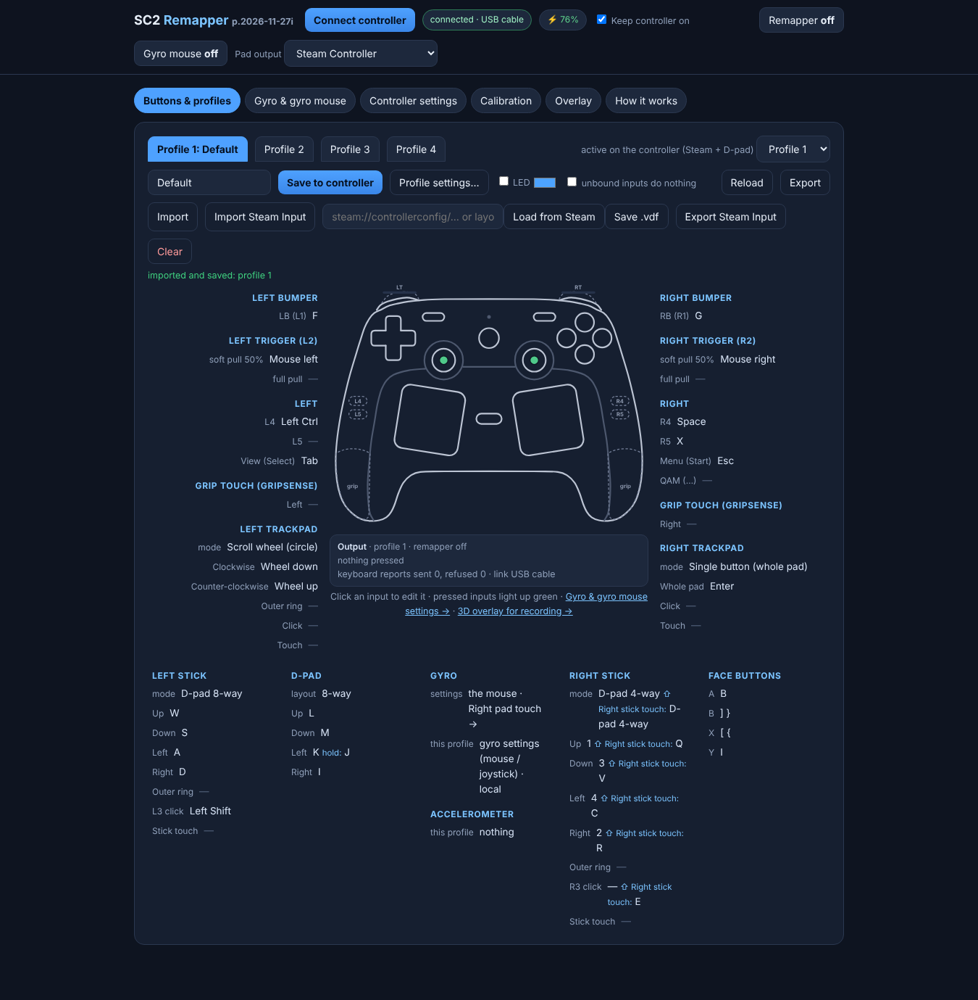
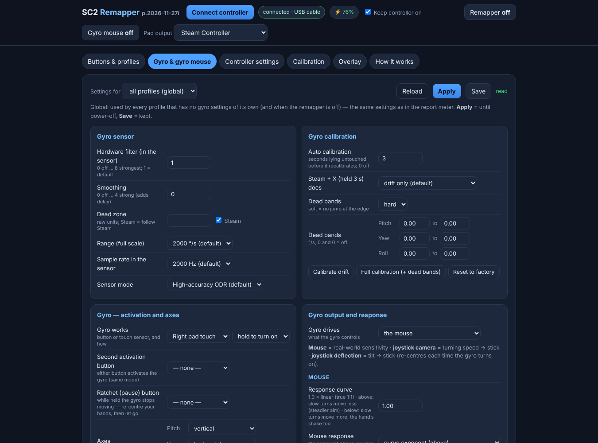
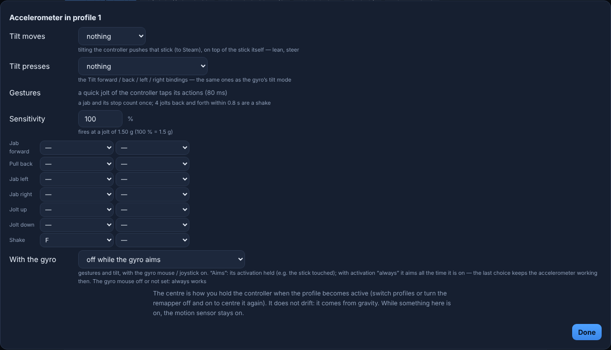
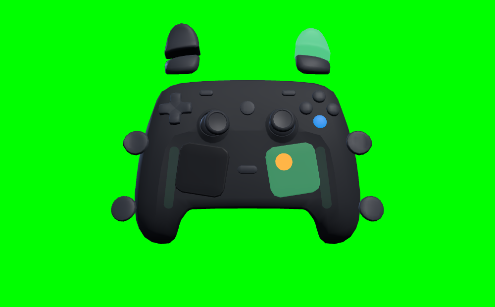

# sc26re 1 kHz

> Custom firmware for the Steam Controller (2026) with 1 kHz reports, a 1 kHz gyro and a remapper that runs inside the controller, plus browser tools and a desktop overlay app.

This is a fork of [mwdmwd/sc26re](https://github.com/mwdmwd/sc26re), the open-source reimplementation of the controller's firmware. It is unofficial and is not affiliated with, endorsed by, or supported by Valve Corporation. This repository does not contain Valve firmware images.

**[Download the latest firmware](https://github.com/pablo89898991/sc26re-1khz/releases/latest)** · **[Tools in the browser](https://pablo89898991.github.io/sc26re-1khz/)** · **[SC2 Overlay app](https://github.com/pablo89898991/sc26re-1khz/releases?q=overlay)**

## What this fork adds

**Faster reports**
- **About 1000 reports per second over USB**, against 250 with the original firmware.
- **About 1000 per second over the Puck** from the controller. The official Puck firmware caps the link at about 240; the [Firmware Patcher](https://pablo89898991.github.io/sc26re-1khz/patcher.html) can patch it to about 500 to 830.
- **Gyro at 1000 Hz** (accelerometer 500 Hz), with fresh motion data in almost every report.
- **Trackpads polled every 1 ms** instead of every 4 ms (about 300 frames per second while touched, up from 250).

**A remapper inside the controller**
- Four profiles stored in the controller. Every input can become keyboard keys, mouse buttons and movement, or Steam / Xbox pad buttons: back buttons, stick touch, grip touch, trackpads, triggers (soft and full pull), the gyro and the accelerometer.
- It works **without Steam** and on any computer. Switch profiles on the controller with Steam + D-pad.
- Button modes (hold, double tap, turbo, toggle), shifts, layers, macros, response curves for the sticks and the gyro.
- **Gyro mouse / joystick**: activation by a button or by touching a stick, real-world sensitivity with a 360° calibration, flick stick.
- **Accelerometer**: tilt as a stick or as buttons, and motion gestures (jabs, jolts, shake).
- **Steam Input layouts**: import a `.vdf` file or a community layout straight from its `steam://controllerconfig/...` link, and export your profiles back to Steam Input.



<table><tr>
<td width="50%"><br><sub>Gyro and gyro mouse settings</sub></td>
<td width="50%"><br><sub>Accelerometer: tilt and motion gestures</sub></td>
</tr></table>

## Download and flash

1. **Save your profiles first.** Flashing erases the custom firmware's storage, so remapper profiles are lost on every update. In the [Remapper](https://pablo89898991.github.io/sc26re-1khz/remap.html), press **Export** for each profile, and **Import** them after flashing.
2. Download **`SC26RE_1k.fw`** from the [latest release](https://github.com/pablo89898991/sc26re-1khz/releases/latest). Every release lists what changed.
3. Open the [Report Meter](https://pablo89898991.github.io/sc26re-1khz/meter.html) in Chrome or Edge, connect the controller with a USB cable, and flash the file with its flasher. The [Ibex Web Utilities](https://opensteamcontroller.github.io/Ibex-Web-Utilities/) flash the same files, including Valve's original firmware if you want to go back.

If the controller does not start, put it in Valve's bootloader by hand: hold **View + Menu + A**, then press **Steam** to power it on, and flash again.

> [!CAUTION]
> This is experimental firmware. Flashing can break your controller, temporarily or permanently. Use it at your own risk; there is no warranty of any kind. Do not flash it if you cannot afford to lose this controller.

## Tools

All the tools run in Chrome or Edge (WebHID) and open offline once you have visited them:

- **[Remapper](https://pablo89898991.github.io/sc26re-1khz/remap.html)**: profiles, bindings, gyro mouse and accelerometer settings, laid out like Steam Input's controller page.
- **[Report Meter](https://pablo89898991.github.io/sc26re-1khz/meter.html)**: report rate, jitter and fresh gyro samples, calibration, and the firmware flasher.
- **[3D Overlay](https://pablo89898991.github.io/sc26re-1khz/overlay.html)**: a 3D controller that follows your hands, for recordings and streams (capture it in OBS with a chroma key).

  
- **[Firmware Patcher](https://pablo89898991.github.io/sc26re-1khz/patcher.html)**: patches Valve's controller and Puck firmware in the browser (USB 1 kHz, 1 kHz gyro, faster Puck polling).

**[SC2 Overlay](https://github.com/pablo89898991/sc26re-1khz/releases?q=overlay)** is the desktop app for **Windows and Linux**: the 3D overlay next to your game, every tool above in its tray icon (no browser or internet needed), the controller's battery, Steam layout downloads, and a notice when new firmware is out.

## Building

```sh
make app-ibex
```

The firmware is a [Zephyr](https://zephyrproject.org/) application in [`app/`](app/) (upstream Zephyr with its free Bluetooth controller, no Nordic binary libraries). The web tools are plain pages in [`web/`](web/), the desktop app is in [`desktop/`](desktop/), and the simulator and tests of the remapper are in [`tools/sim/`](tools/sim/). Measurements and the changes against upstream are in [`docs/1KHZ.md`](docs/1KHZ.md). Read [`app/README.md`](app/README.md) before changing anything about flash layout or storage.

## Thanks

- **[mwdmwd](https://github.com/mwdmwd)** and the contributors of [sc26re](https://github.com/mwdmwd/sc26re), which this firmware is built on.
- **Rhyn0_Rang3r**, our Discord tester, for testing the releases and for the Linux version of SC2 Overlay.
- Everyone on the project's Discord who tested builds and reported bugs.

## License

This program is free software: you can redistribute it and/or modify it under the terms of the GNU Affero General Public License as published by the Free Software Foundation, either version 3 of the License, or (at your option) any later version. It is distributed in the hope that it will be useful, but WITHOUT ANY WARRANTY; without even the implied warranty of MERCHANTABILITY or FITNESS FOR A PARTICULAR PURPOSE. See [LICENSE](LICENSE) and https://www.gnu.org/licenses/.

Files under [app/src/sdl/](app/src/sdl/) are derived from SDL and retain SDL's zlib-style license; see [app/src/sdl/LICENSE.txt](app/src/sdl/LICENSE.txt).
